# 🏨 Hotel Management System

A full-stack hotel management system built with **Node.js** for the backend and **React.js** for the frontend. The system allows efficient management of hotel operations such as room booking, customer information, employee tracking, and reports.

## 📁 Project Structure

hotel-management/
├── backend/ # Node.js + Express backend (with MySQL)
└── frontend/ # React.js frontend

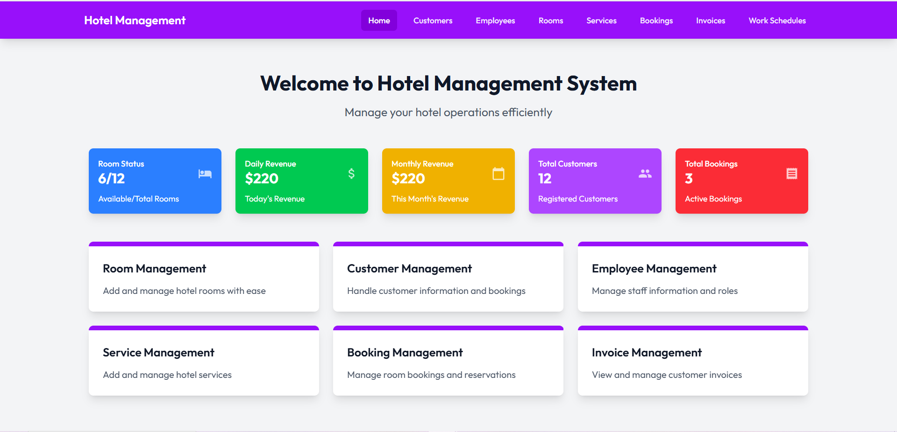


## 🚀 Features

- Room and customer management
- Booking, check-in/check-out workflow
- Staff performance and scheduling
- Revenue & occupancy reporting
- Dashboard with real-time data
- (Optional) Multi-language support

## 🛠️ Technologies Used

- **Frontend:** React.js, Axios, React Router
- **Backend:** Node.js, Express.js, MySQL
- **Others:** Sequelize (ORM)

## ⚙️ Getting Started
```bash
### 1. Clone the Repository


git clone https://github.com/vuphan04/hotel-management-prj1-main
cd hotel-management-prj1
2. Set Up the Database (MySQL)
Create a MySQL database (e.g., hotel_db)

Update the .env file in the backend/ folder with your MySQL config:

env

DB_HOST=
DB_PORT=
DB_USER=
DB_PASSWORD=yourpassword
DB_NAME=hotel_db

3. Start the Backend

cd backend
npm install
npm run dev
The backend server will start on http://localhost:5000 (or your configured port).

4. Start the Frontend
Open a new terminal:


cd frontend
npm install
npm run dev

The frontend will run at http://localhost:5173.
```
## 📷 Screenshots
### 🏠 Home Page


### 📋 Booking Module
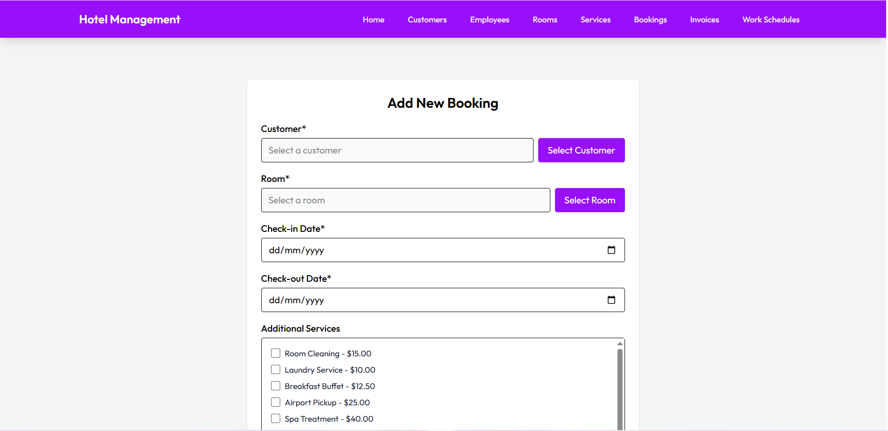  
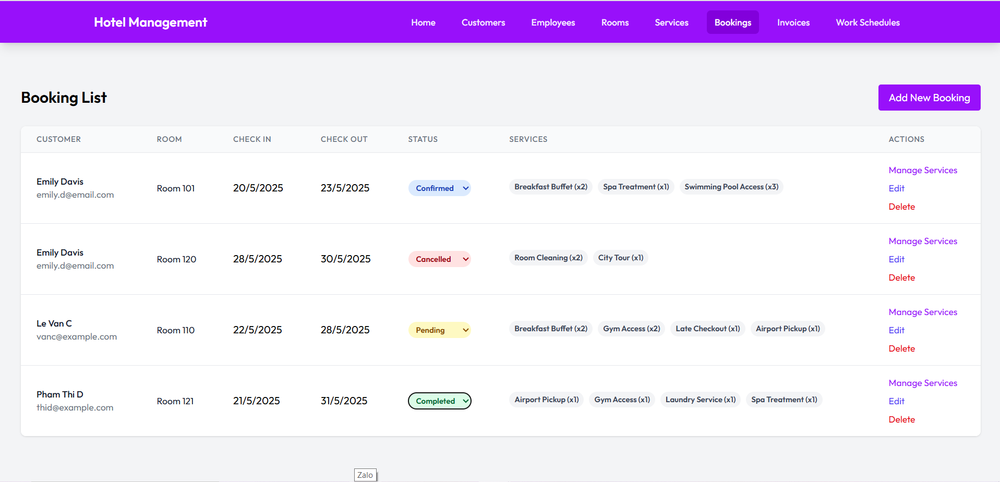

### 👤 Customer Module
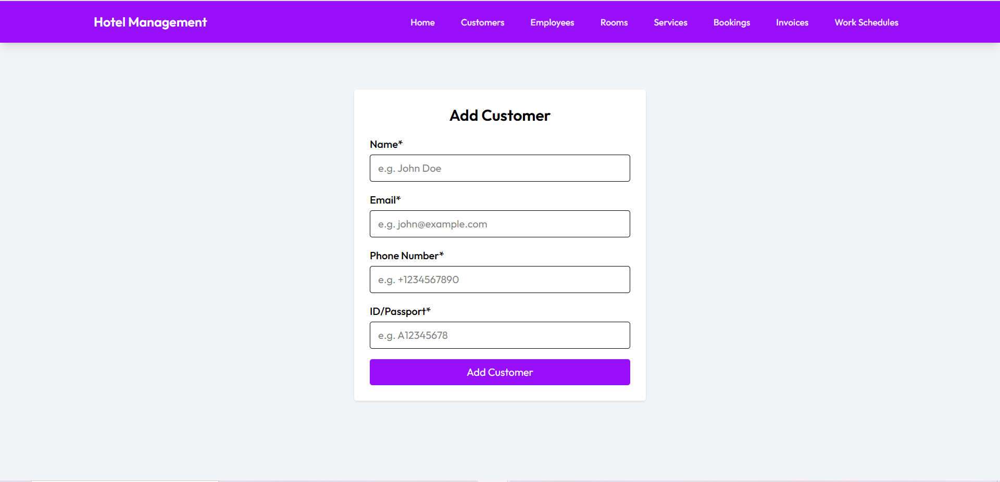  
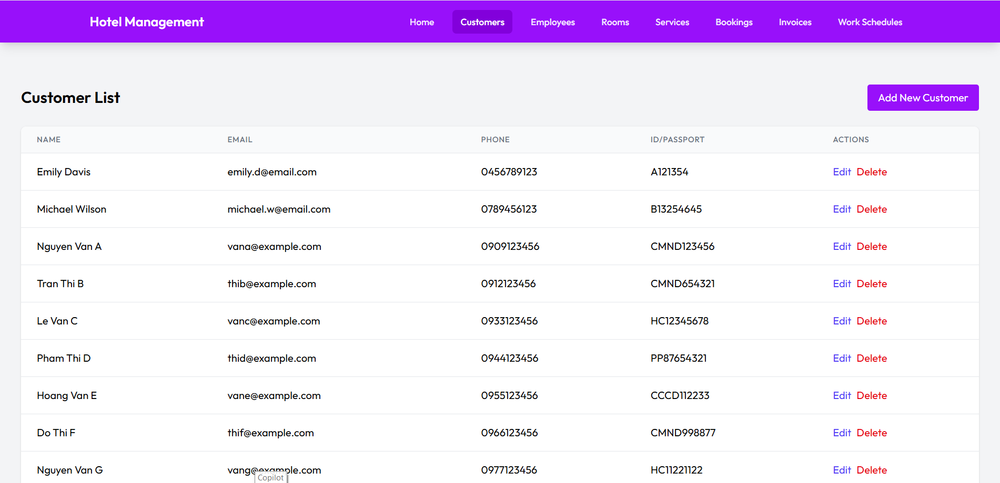

### 👨‍💼 Employee & Work Schedules Module
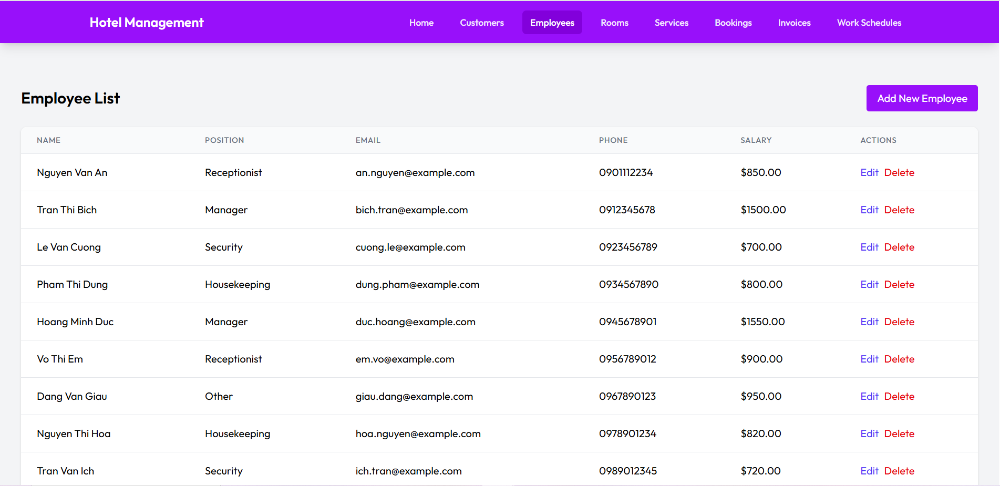  
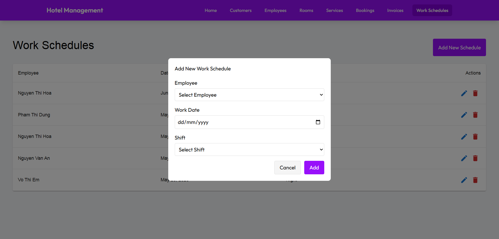  
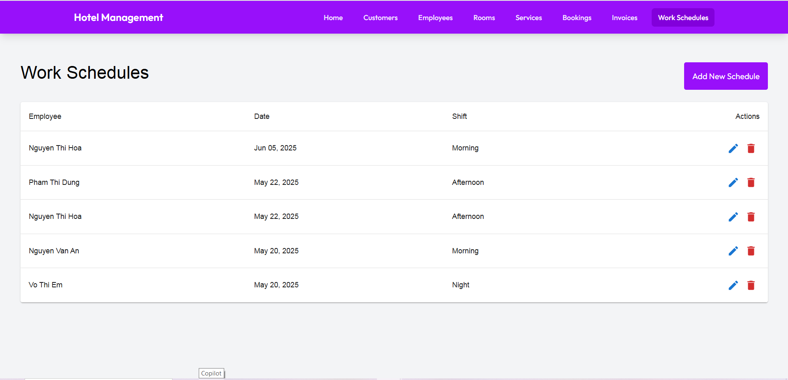

### 🧾 Invoice Module
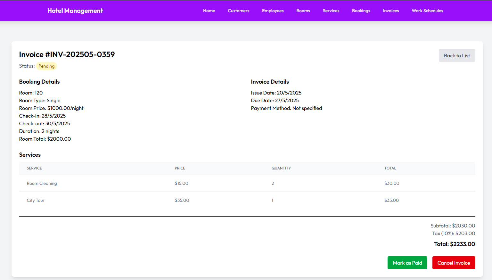  
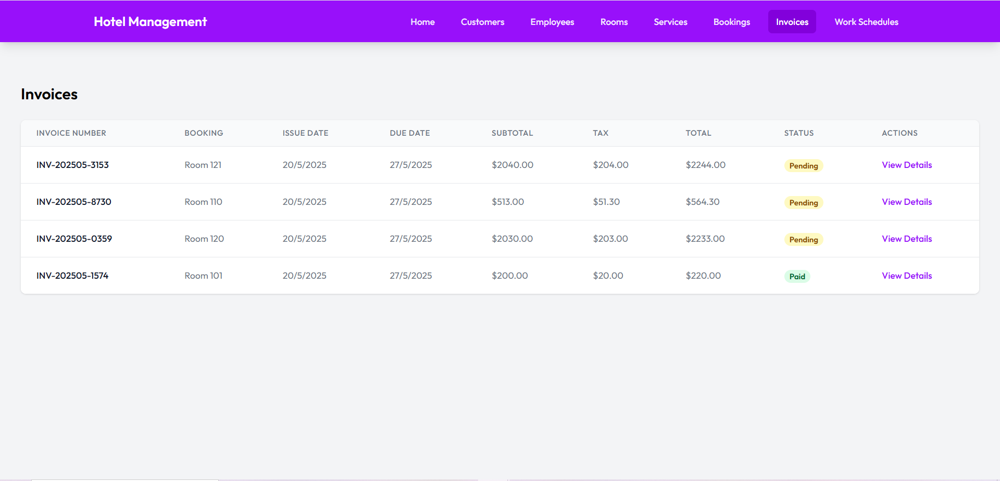

### 🛏️ Room Module
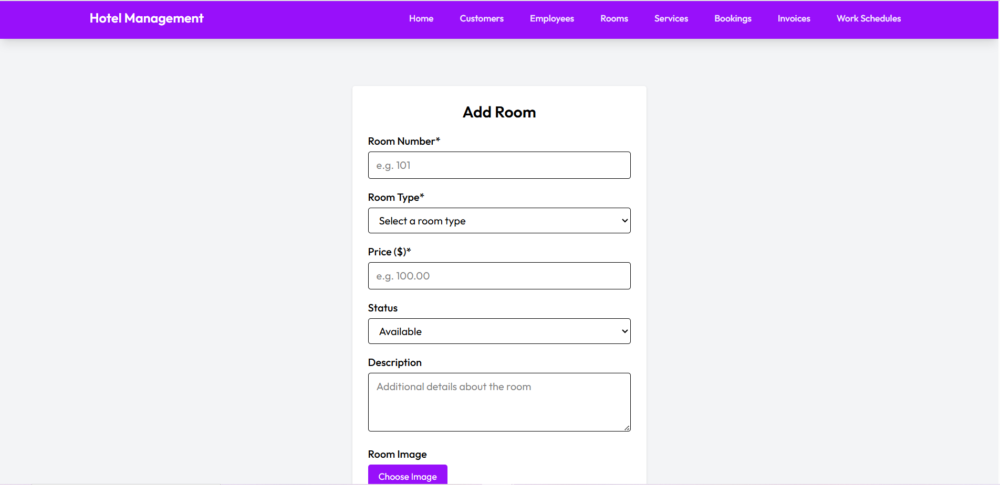  
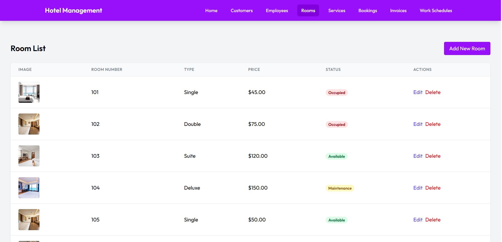

### 🧰 Services Module
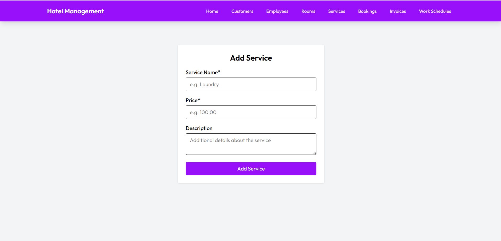  
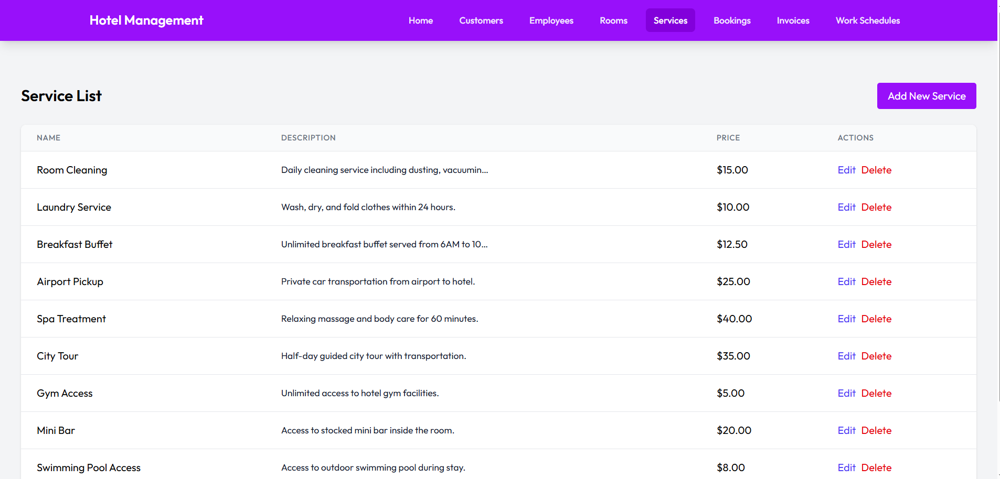

## 🧪 Future Improvements
Unit testing with Jest and React Testing Library

CI/CD with GitHub Actions

Error boundaries and better error handling

Accessibility improvements

PWA support for offline usage

Internationalization with react-i18next

## 📄 License
This project is licensed under the MIT License.
